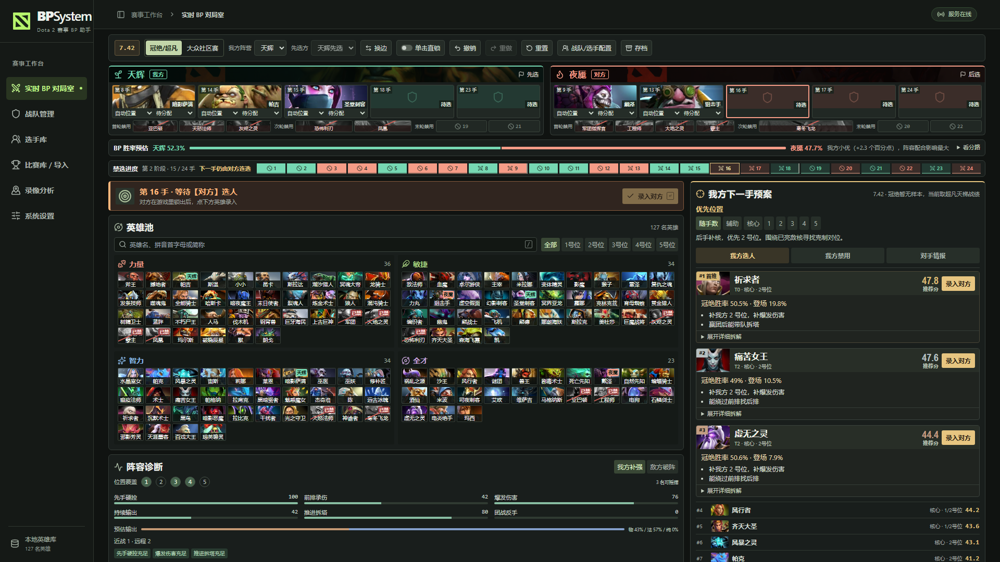
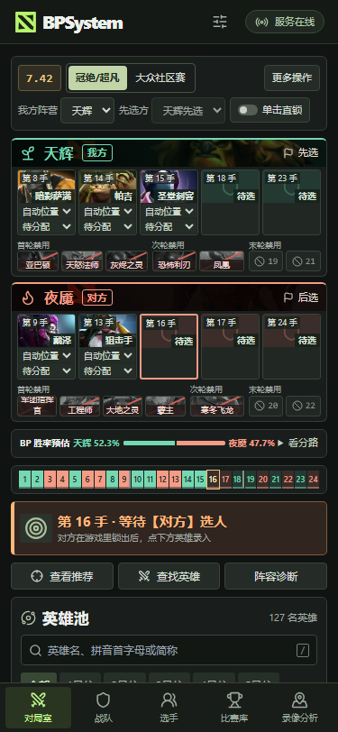

# BPSystem · Dota 2 实时 BP 决策助手

BPSystem 面向 Dota 2 社区赛、高校赛和战队训练。在一台电脑上启动服务，队长、教练和导播就能用 PC 或同一局域网内的手机浏览器打开对局室，现场录入禁选、查看下一手建议，赛后按选手复盘。生产版支持 PWA。

项目内置 **7.42 全部 127 名可选英雄**，每名英雄都可按国服黑话、简称或拼音首字母搜索。完整物品图鉴收录 567 个物品 ID（含图纸和历史物品），供比赛记分板识别出装。录像热力图使用随包提供的 7.42 小地图。

## 界面预览

两张截图均取自第 16 手等待对方选人的局面。桌面首屏并列展示四属性英雄池和推荐卡，手机可点「查看推荐」跳到下一手预案。

**桌面对局室 · 1920 × 1080**



<details>
<summary>展开手机端对局室 · 375 × 812</summary>



</details>

## 核心功能

### 24 手 CM 对局室

- 我方阵营（天辉／夜魇）和先选方可独立切换。对局室按队长模式（CM）的 14 禁、10 选推进。轮到对方时，导播可录入对方英雄，同时查看我方下一手预案。
- 桌面一屏按力量、敏捷、智力、全才展示 127 名英雄。可组合使用位置和搜索词，例如搜「电棍」找剃刀，搜 `es` 可看到小牛和土猫。单击预选，按 Enter 确认，也可开启「单击直锁」。锁定成功后自动清空搜索和临时位置筛选。
- 点任一已锁定的禁人或选人肖像即可原位换英雄，后续手数保留。选人槽还可单独改 1–5 号位和选手归属，走满 24 手也能纠错。

### 高分天梯推荐与绝活预警

OpenDota 天梯榜先在每个段位内计算登场率、平滑胜率，再按固定权重合成。7.42 是内置快照的采样版本，天梯数据采用 OpenDota 的滚动统计。

| 天梯样本 | 冠绝 | 超凡 | 万古 | 传奇 |
| --- | ---: | ---: | ---: | ---: |
| 四档均有样本 | 40% | 28% | 20% | 12% |
| 内置快照（冠绝整档无样本） | 0% | 68% | 20% | 12% |

冠绝缺档时，超凡承接高分两档合计的 68%，传奇场次再多也不会稀释这部分权重。职业赛选取和禁用对版本强度的权重均为 0。有可用选手英雄池时，推荐默认由 **82% 对局因素**（版本强度、阵容、对位、禁选顺位）和 **18% 个人英雄池**组成，选手表现以 7.42 起的战绩为主。空阵容也能直接使用本地数据推荐。

陈、小精灵、米波、熊德、蜘蛛等高操作门槛英雄，以及综合登场率 **低于 2.5%** 的英雄，默认排除在选人、补强和破阵推荐之外。队内尚能接该位置的选手使用该英雄达到以下任一条件，即可解锁推荐。

- 7.42 起，天梯与赛事合计至少 3 场，胜率至少 50%，重叠场次只计一次。
- 7.42 起，赛事至少 2 场，赛事胜率至少 50%。

禁人榜（Ban 榜）按敌方阵容检查同一条件。对手有能接该位置的绝活选手时，对应英雄提高禁用优先级，并以红色标出「敌方绝活预警」。

### 阵容诊断与三路预测

每次禁选都会更新双方的先手硬控、前排承伤、爆发伤害、持续输出、推进拆塔和团战反手六项评分。「我方补强」列出能补短板的人选，「敌方破阵」列出能利用敌方弱点的人选，点英雄即可预选，开启直锁后可一键锁定。单行「BP 胜率预估」显示两方的阵容胜率估算。双方各亮出至少两名英雄后，展开「看分路」可查看优势路、中路和劣势路的对线预测。

### 选手录像与战队数据

- **录像复盘**　在比赛库为已导入的比赛请求 OpenDota 录像解析，客户端轮询进度，完成后回填本地数据。进入录像分析先选人，可合看该选手全部已解析场次，也可下钻到单场。在 7.42 小地图上按时段查看真假眼落点，或用整场位置采样的热力分布查看刷钱路线。
- **战队预设**　录入 Steam32、Steam64 或 OpenDota／Dotabuff 选手主页链接即可识别账号。保存五人首发和替补后，可在对局室载入阵容。比赛库支持批量粘贴比赛 ID 或链接。
- **存档与备份**　当前草稿自动保存在本机浏览器，手动存档后可在同一服务的其他设备载入。「系统设置」支持 JSON 全量备份与恢复，覆盖选手、战队、比赛、录像数据、BP 存档及分析设置。恢复会替换服务器业务数据，并保留本机接口密钥。

## 技术栈与目录

后端使用 Node.js 24、Express 5 和 TypeScript，直接通过内置 `node:sqlite` 的 `DatabaseSync` 读写 SQLite，无需编译原生 C++ 数据库驱动。前端使用 React 19、Vite 6 和 Tailwind CSS，生产构建包含 PWA 应用清单和 Service Worker。

| 目录 | 内容 |
| --- | --- |
| `server/` | REST API、数据库迁移、7.42 数据快照、推荐与录像分析逻辑，以及自动化测试。 |
| `web/` | 对局室、选手与战队管理、比赛库和录像分析界面，以及本地肖像、小地图和离线缓存。 |
| `docs/codex/` | 各阶段的功能设计、数据口径、验收记录和 API 参考。 |
| `data/` | 运行时数据目录，默认数据库为 `data/bpsystem.sqlite`，首次启动时创建。 |

## 快速开始与常用命令

使用 **Node.js 24.x** 和 **npm 11 或更高版本**。在仓库根目录安装依赖、构建并启动服务。

```sh
npm install
npm run build
npm start
```

电脑打开 `http://localhost:3001`。Express 默认监听 `0.0.0.0:3001`，同一端口提供网页和 `/api`。手机连入电脑所在的局域网后，在手机浏览器打开 BPSystem「系统设置 → 手机局域网访问」列出的地址，例如 `http://192.168.1.20:3001`。

| 命令 | 用途 |
| --- | --- |
| `npm run dev` | 同时启动后端与 Vite 开发服务。电脑打开 `http://localhost:5173`，手机使用设置页给出的 5173 端口地址，Vite 将 `/api` 转发至后端。 |
| `npm run typecheck` | 对服务端和前端执行 TypeScript 类型检查。 |
| `npm test` | 运行服务端的 79 项自动化测试。 |
| `npm run build` | 编译服务端并构建前端生产资源。 |
| `npm start` | 启动已构建的生产服务。开发和生产模式默认共用后端端口，切换前先停止当前服务。 |

**可选配置**　在「系统设置 → OpenDota 接口密钥」保存 API Key 可提高请求额度。服务优先使用设置页保存的密钥，其次读取环境变量 `OPENDOTA_API_KEY`，都未配置时使用公共额度。`PORT` 可更改后端监听端口，`DB_PATH` 可更改 SQLite 文件路径。

**离线使用**　普通局域网 HTTP 地址可直接使用手机网页版。生产版通过 HTTPS 或本机 localhost 首次联网加载并完成缓存后，PWA 可离线回退到应用页面，读取已缓存的肖像和地图。推荐、查询和存档需要连接本地服务，更新 OpenDota 数据和请求录像解析还需要服务端联网。

## 更多文档

- [第七阶段 · 社区赛 BP 规则、操作与截图验收](docs/codex/phase-7-community-ux.md)
- [REST API 参考 · 请求参数、响应与示例](docs/codex/api.md)
